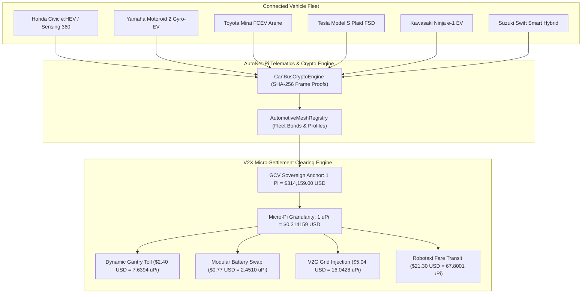

<div align="center">

# AutoNet-Pi: Autonomous Vehicular V2X Telematics & Multi-OEM Mesh
### Cross-Manufacturer Telematics Abstraction Layer (Honda, Yamaha, Toyota, Tesla, Kawasaki, Suzuki) & GCV $314,159 Kinetic Clearing for Pi Network

[](https://opensource.org/licenses/Apache-2.0)
[](https://openjdk.org/)
[](#1-multi-oem-telematics-abstraction-layer)
[](#supported-oem-platforms)
[](#3-gcv-31415900-usd-micro-settlement-matrix)
[](#running-verification-tests)

```
   ___         _          _  _       _         ___  _ 
  /   \ _   _ | |_  ___  | \| | ___ | |_      | _ \(_) 
 / /\ /| | | || __|/ _ \ | .` |/ -_)|  _|  _  |  _/| |
/_/  \_\\_,_/ \__|\___/ |_|\_|\___| \__| (_) |_|  |_|
 >> AUTONOMOUS V2X TELEMATICS & MULTI-OEM MOBILITY MESH <<
 >> HONDA | YAMAHA | TOYOTA | TESLA | KAWASAKI | SUZUKI <<
```

**Next-Generation Connected Vehicle Telematics, CAN Bus Cryptographic Attestation & Micro-Settlement Protocol**

</div>

---

## 🌟 Overview

**AutoNet-Pi** is an enterprise-grade, decentralized automotive protocol engineered in **Java 21 LTS**. It bridges real-world vehicle telemetry from premier global automotive manufacturers—including **Honda, Yamaha, Toyota, Tesla, Kawasaki, and Suzuki**—with the **Pi Network** consensus layer.

By establishing a unified **Telematics Abstraction Layer (TAL)**, AutoNet-Pi converts internal CAN-FD and C-V2X (Cellular Vehicle-to-Everything) signals into tamper-proof cryptographic proofs. This allows connected vehicles to execute autonomous, trustless micro-settlements for road usage tolls, modular battery swaps, Vehicle-to-Grid (V2G) power injections, and robotaxi fares using the **Global Consensus Value (GCV) anchor of $314,159.00 USD / Pi**.

---

## 🏎️ Supported OEM Platforms

AutoNet-Pi features native telemetry drivers and cryptographic state adapters for major global manufacturers:

| OEM Brand | Platform Architecture | Standard Powertrain / Telematics Protocol |
| :--- | :--- | :--- |
| **HONDA** | *Honda e:Architecture / Sensing 360* | Mobile Power Pack e: modular swappable battery telemetry, ADAS radar verification |
| **YAMAHA** | *Motoroid 2 AI Gyro-Kinetic OS* | 6-axis IMU lean kinematics, high-torque regenerative braking, Y-Connect EV link |
| **TOYOTA** | *Woven Planet Arene OS* | Toyota Safety Sense V2X gateway, Mirai hydrogen fuel-cell logs, bZ4X grid mesh |
| **TESLA** | *Tesla FSD Neural Telemetry* | Full Self-Driving robotaxi dispatch, Megapack bi-directional V2G Supercharger exchange |
| **KAWASAKI** | *Ninja e-1 Rideology Telematics* | Dual-pack lithium-ion discharge curve, e-boost kinetic energy harvesting |
| **SUZUKI** | *Smart Hybrid & S-CNG Eco-Matrix* | Ultra-lightweight urban micro-mobility efficiency metrics, green transport credits |

---

## 🔬 System Architecture



---

## 💰 GCV $314,159.00 USD Micro-Settlement Matrix

Under traditional financial rails, micro-transactions incur disproportionate fees. Anchored to the **Global Consensus Value of $314,159.00 USD / Pi**, AutoNet-Pi leverages micro-denominations for friction-free sub-cent vehicular billing:

$$\text{Amount}_{\Pi} = \frac{\text{Amount}_{\text{USD}}}{314,159.00}$$

* **Mega-Pi ($1.0\,\Pi = \$314,159.00\text{ USD}$):** Serves as sovereign bonded insurance collateral for autonomous commercial robotaxis and freight corridors.
* **Micro-Pi ($1.0\,\mu\Pi = 10^{-6}\,\Pi = \$0.314159\text{ USD}$):** Standard unit for highway toll passages, battery swapping, and parking tariffs.
* **Nano-Pi ($1.0\,n\Pi = 10^{-9}\,\Pi = \$0.000314\text{ USD}$):** Granular unit for millisecond-level dynamic lane priority auctions and V2X collision avoidance packet rewards.

---

## 📦 Directory Structure

```text
autonet-pi/
├── src/
│   ├── main/
│   │   └── java/
│   │       └── io/
│   │           └── autonet/
│   │               └── pi/
│   │                   ├── Main.java                          # CLI entry point & demonstration runner
│   │                   ├── constants/
│   │                   │   └── AutoConstants.java             # GCV $314,159 & CAN protocol constants
│   │                   ├── model/
│   │                   │   ├── OemBrand.java                  # Honda, Yamaha, Toyota, Tesla, etc.
│   │                   │   ├── VehicleProfile.java            # Certified vehicle DID record
│   │                   │   ├── TelematicsFrame.java           # CAN bus cryptographic telemetry frame
│   │                   │   ├── SettlementType.java            # Toll, Battery Swap, V2G, Fare
│   │                   │   └── SettlementRecord.java          # Immutable ledger transaction entry
│   │                   ├── telematics/
│   │                   │   ├── CanBusCryptoEngine.java        # Anti-tampering SHA-256 hash engine
│   │                   │   ├── OemTelemetryAdapter.java       # Telematics Abstraction Layer interface
│   │                   │   └── adapters/
│   │                   │       ├── HondaTelematicsAdapter.java
│   │                   │       ├── YamahaTelematicsAdapter.java
│   │                   │       ├── ToyotaTelematicsAdapter.java
│   │                   │       ├── TeslaTelematicsAdapter.java
│   │                   │       ├── KawasakiTelematicsAdapter.java
│   │                   │       └── SuzukiTelematicsAdapter.java
│   │                   ├── settlement/
│   │                   │   └── V2XSettlementEngine.java       # GCV micro-settlement clearinghouse
│   │                   ├── mesh/
│   │                   │   └── AutomotiveMeshRegistry.java    # Decentralized fleet registry
│   │                   └── cli/
│   │                       └── AutoNetConsole.java            # Terminal HUD & ANSI reporting
│   └── test/
│       └── java/
│           └── io/
│               └── autonet/
│                   └── pi/
│                       └── AutoNetTestSuite.java              # 17-point verification test suite
├── whitepaper/
│   └── AUTONET_PI_SPECIFICATION.md                            # Complete engineering whitepaper
├── pom.xml                                                    # Maven project descriptor
├── build.bat                                                  # Windows build script
├── build.sh                                                   # POSIX build script
├── .gitignore
├── LICENSE                                                    # Apache License 2.0
└── README.md
```

---

## ⚡ Quick Start

### Prerequisites
* **Java 21 LTS** or newer (`javac` and `java` available on PATH).
* No external Maven or Gradle dependencies required—compiles completely using standard Java libraries.

### Compilation & Execution

#### On Windows:
```cmd
cd autonet-pi
build.bat
```

#### On Linux / macOS:
```bash
cd autonet-pi
chmod +x build.sh
./build.sh
```

#### Direct Compilation via `javac`:
```bash
# 1. Compile all source files
javac -d bin $(find src/main/java src/test/java -name "*.java")

# 2. Run unit tests
java -cp bin io.autonet.pi.AutoNetTestSuite

# 3. Launch live Terminal HUD demo
java -cp bin io.autonet.pi.Main demo
```

---

## 🧪 Running Verification Tests

The built-in test suite validates GCV mathematics, cryptographic tamper resistance, and cross-OEM adapters:

```bash
java -cp bin io.autonet.pi.AutoNetTestSuite
```

Expected output:
```text
Running AutoNet-Pi Verification Test Suite...
 [PASS] GCV Conversion: $314,159.00 USD == 1.0 Pi
 [PASS] GCV Conversion: $0.314159 USD == 1 uPi
 [PASS] Crypto Engine: Valid Frame Verification
 [PASS] Crypto Engine: Tampered Speed Rejected
 [PASS] OEM Brand Check: Honda
 [PASS] OEM Brand Check: Yamaha
 [PASS] OEM Brand Check: Toyota
 [PASS] OEM Brand Check: Tesla
 [PASS] OEM Brand Check: Kawasaki
 [PASS] OEM Brand Check: Suzuki
 [PASS] Registry: Compliant Bond Accepted
 [PASS] Registry: Under-bonded Vehicle Rejected
 [PASS] V2X Settlement: Toll Micro-Pi Amount (10 uPi)
 [PASS] V2X Settlement: Toll USD Valuation ($3.14 USD)
 [PASS] V2X Settlement: Battery Swap Amount ($1.00 USD)
 [PASS] Ledger Hash Evolves deterministically
 [PASS] Ledger Records Count == 2
----------------------------------------------------------------------
Test Execution Complete: 17 / 17 tests passed successfully.
```

---

## 💻 Java API Integration Example

```java
import io.autonet.pi.constants.AutoConstants;
import io.autonet.pi.model.VehicleProfile;
import io.autonet.pi.telematics.CanBusCryptoEngine;
import io.autonet.pi.telematics.adapters.HondaTelematicsAdapter;
import io.autonet.pi.settlement.V2XSettlementEngine;

// 1. Initialize Crypto & Settlement Engines
CanBusCryptoEngine crypto = new CanBusCryptoEngine();
V2XSettlementEngine engine = new V2XSettlementEngine(crypto);

// 2. Instantiate Honda OEM Adapter
HondaTelematicsAdapter honda = new HondaTelematicsAdapter(crypto);
VehicleProfile civic = honda.createProfile(
    "Honda Civic e:HEV Sensing", "JH4FL1H89PX1001", "HYBRID_ELECTRIC", 1.5);

// 3. Process Autonomous Toll Crossing ($2.40 USD)
var record = engine.settleToll(civic.vehicleDid(), "gantry:toll:shuto-c1", 2.40);

System.out.printf("Toll Cleared: %.4f uPi ($%.2f USD) [GCV Benchmark: $%,.0f]%n",
    record.getAmountMicroPi(), record.getAmountUsd(), AutoConstants.GCV_VALUATION_USD);
```

---

## 📑 Technical Whitepaper

For formal proofs on CAN bus cryptographic hash chaining, latency budgets, and micro-settlement consensus, refer to the [AutoNet-Pi Specification Whitepaper](whitepaper/AUTONET_PI_SPECIFICATION.md).

---

## ⚖️ License

Distributed under the **Apache License, Version 2.0**. See the [LICENSE](LICENSE) file for complete details.

```text
Copyright 2026 AutoNet-Pi Sovereign Automotive Mesh Contributors

Licensed under the Apache License, Version 2.0 (the "License");
you may not use this file except in compliance with the License.
You may obtain a copy of the License at

    http://www.apache.org/licenses/LICENSE-2.0
```
