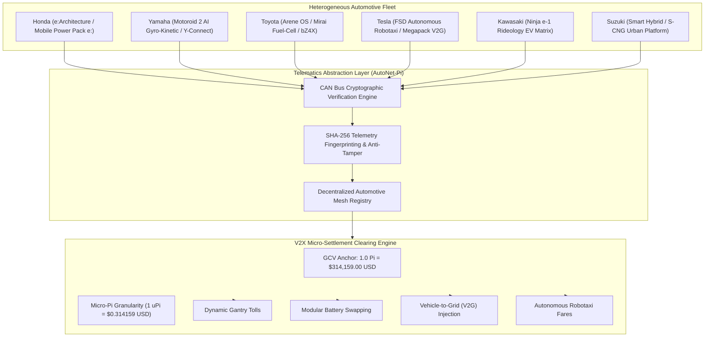

# AUTONET-PI: SOVEREIGN AUTOMOTIVE V2X PROTOCOL SPECIFICATION
## Decentralized Connected Vehicle Telematics, Multi-OEM Abstraction Layer, and Kinetic Micro-Settlement Mesh for the Pi Network Ecosystem

**Specification Version:** *v1.0.0-PROD*  
**Architecture:** *Automotive Open System Architecture (AUTOSAR) & C-V2X Rel-16*  
**Implementation Language:** *Java 21 (LTS Enterprise Grade)*  
**License:** *Apache License, Version 2.0*  

---

### EXECUTIVE SUMMARY
The convergence of autonomous driving, electric propulsion, and smart grid infrastructure demands a unified, trustless protocol for vehicular telemetry and cross-OEM economic clearance. Contemporary connected vehicles remain siloed within proprietary vendor clouds, preventing seamless peer-to-peer (P2P) clearing for energy exchange, road usage tariffs, and fleet coordination.

**AutoNet-Pi** establishes a cross-manufacturer vehicular telemetry and decentralized clearing protocol anchored to the **Pi Network**. By providing a unified **Telematics Abstraction Layer (TAL)** across major automotive OEMs—including **Honda, Yamaha, Toyota, Tesla, Kawasaki, and Suzuki**—AutoNet-Pi enables tamper-evident CAN bus cryptographic proofs, real-time Vehicle-to-Everything (V2X) interactions, and frictionless micro-settlements anchored to the **Global Consensus Value (GCV) benchmark of $314,159.00 USD / Pi**.

---

### 1. MULTI-OEM TELEMATICS ABSTRACTION LAYER (TAL)

AutoNet-Pi provides native abstraction adapters across heterogeneous vehicle architectures:

#### Detailed Manufacturer Implementations:
1. **Honda Motor Co., Ltd. (Honda e:Architecture & Honda Sensing 360):**
   * Translates powertrain status and ADAS safety flags into tamper-proof telemetry.
   * Standardizes billing for **Honda Mobile Power Pack e:** swappable battery kiosks.
2. **Yamaha Motor Co., Ltd. (Motoroid 2 AI Gyro-Kinetic Platform):**
   * Captures high-frequency 6-axis IMU gyroscopic lean angles, torque vectoring, and motorcycle regenerative kinetic energy.
3. **Toyota Motor Corporation (Toyota Arene OS & Safety Sense V2X):**
   * Integrates hydrogen consumption logs from Mirai fuel-cell stacks and grid power draw from bZ4X electric powertrains into the decentralized mesh.
4. **Tesla, Inc. (Full Self-Driving Neural Telemetry & Megapack V2G):**
   * Tracks autonomous disengagement metrics, passenger fare micro-settlements, and bi-directional DC high-power grid feedback.
5. **Kawasaki Heavy Industries (Ninja e-1 / Z e-1 Rideology Telematics):**
   * Monitors dual-battery discharge profiles, regenerative boost braking, and urban zero-emission corridor transit proofs.
6. **Suzuki Motor Corporation (Smart Hybrid & S-CNG Eco-Matrix):**
   * Aggregates ultra-lightweight city micro-mobility efficiency data for urban green mobility credits.

---

### 2. CAN BUS & C-V2X CRYPTOGRAPHIC TELEMETRY INTEGRATION

Vehicular data frames are harvested directly from the vehicle's internal CAN-FD / Controller Area Network bus:

$$\mathcal{P}_{\text{frame}} = \mathcal{H}_{\text{SHA-256}}\left(\text{DID} \parallel t_{\text{epoch}} \parallel v_{\text{km/h}} \parallel \text{SoC}_{\%} \parallel \text{Odo}_{\text{km}} \parallel \text{ArbID} \parallel \kappa\right)$$

* **Anti-Tampering Invariance:** Any attempt to manipulate odometer readings or spoof velocity modifies the cryptographic fingerprint, instantly disqualifying the vehicle from consensus settlement.
* **Deterministic DID Scheme:** 
  $$\text{DID} = \text{did:pi:auto}:\langle\text{OEM}\rangle:\mathcal{H}_{\text{SHA-256}}(\text{VIN})[0..16]$$

---

### 3. THE GCV $314,159.00 USD MICRO-SETTLEMENT PARADIGM

In conventional fiat payment systems, processing sub-dollar transactions (e.g., passing a \$0.50 toll gantry or discharging \$0.25 of electricity) incurs high merchant fees. Under AutoNet-Pi, the **Global Consensus Value ($314,159.00 USD / Pi)** enables micro-unit denominations:

$$\text{Amount}_{\Pi} = \frac{\text{Amount}_{\text{USD}}}{314,159.00}$$

| Denomination | Pi Unit | USD Valuation at GCV $314,159 | Primary Vehicular Use Case |
| :--- | :--- | :--- | :--- |
| **Mega-Pi** | $1.0\,\Pi$ | $\$314,159.00$ | Autonomous Fleet Insurance Bond & Transit Corridor Collateral |
| **Milli-Pi** | $10^{-3}\,\Pi$ | $\$314.16$ | Long-distance freight transport / bulk battery pack replacement |
| **Micro-Pi ($\mu\Pi$)** | $10^{-6}\,\Pi$ | $\$0.314159$ | Modular battery swap, toll gantry clearance, EV charging |
| **Nano-Pi ($n\Pi$)** | $10^{-9}\,\Pi$ | $\$0.000314$ | Per-meter lane priority auction & millisecond V2X sensor trading |

#### Practical Settlement Formulas:
* **Toll Crossing:**
  $$\Pi_{\text{toll}} = \frac{\text{Toll}_{\text{USD}}}{314,159.00} \quad \implies \quad \$2.40 \text{ USD} = 7.6394\,\mu\Pi$$
* **Modular Battery Swap:**
  $$\Pi_{\text{swap}} = \frac{\text{kWh} \times \text{Tariff}_{\text{USD/kWh}}}{314,159.00} \quad \implies \quad 3.5 \text{ kWh} \times \$0.22 = 2.4510\,\mu\Pi$$
* **V2G Regenerative Grid Injection:**
  $$\Pi_{\text{v2g}} = \frac{\text{kWh}_{\text{injected}} \times \text{FeedInRate}_{\text{USD/kWh}}}{314,159.00} \quad \implies \quad 18.0 \text{ kWh} \times \$0.28 = 16.0428\,\mu\Pi$$

---

### 4. IMMUTABLE CHRONO-LEDGER CHAINING

Every settlement is chained into the cumulative mesh hash:

$$\mathcal{H}_{k} = \mathcal{H}_{\text{SHA-256}}\left(\mathcal{H}_{k-1} \parallel \text{TxID} \parallel \text{DID} \parallel \text{Amount}_{\Pi} \parallel t \parallel \text{Type}\right)$$

This guarantees strict total ordering and eliminates double-spending across roadside units (RSUs), toll gantries, and charging stations.

---

### 5. CONCLUSION
AutoNet-Pi bridges the global automotive manufacturing base with the Pi Network, establishing a high-frequency, mathematically grounded infrastructure for the multi-trillion dollar autonomous transportation era.
